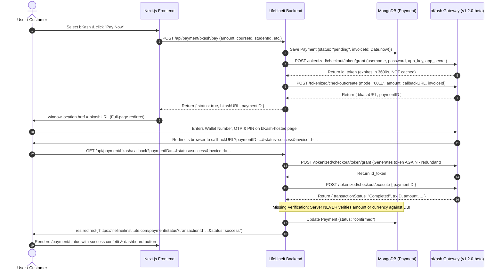
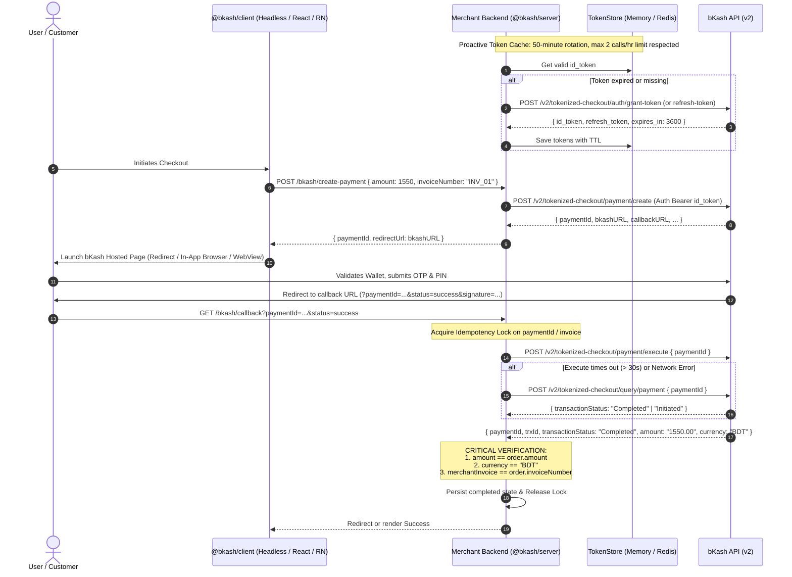
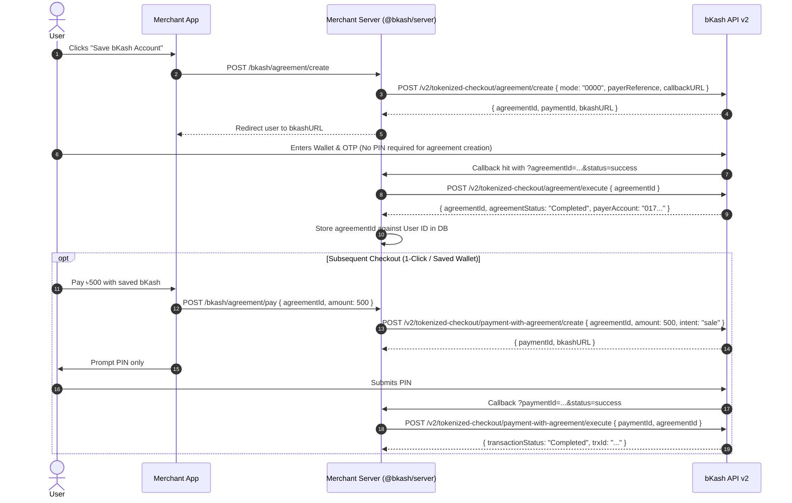
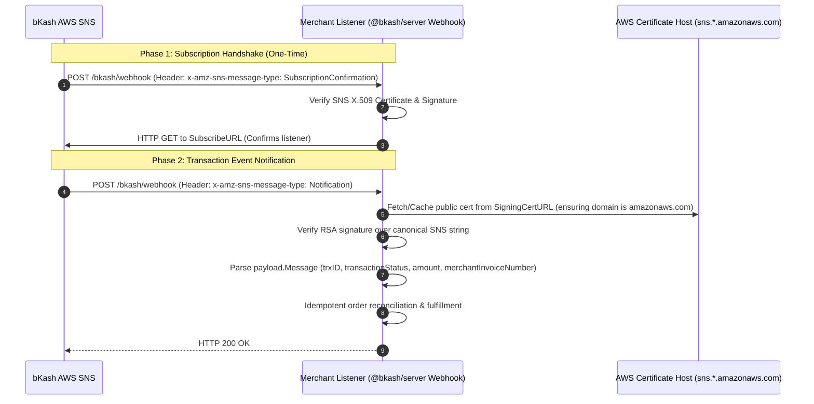

# bKash Payment Gateway Integration — Phase 0 Comprehensive Audit

**Author:** Senior TypeScript Library Engineer  
**Date:** October 25, 2026  
**Status:** Complete — Pending User Review & Approval  
**Target Monorepo:** `bkash-server` and `bkash-client` (TypeScript, ESM/CJS, MIT)  

---

## 1. Executive Summary

This audit evaluates the live working bKash integration from `LifeLineit` (Backend: `/Users/ta-shanto/Coding/clients-projects/rabbi-ctg/LifeLineit/backend`, Frontend: `/Users/ta-shanto/Coding/clients-projects/rabbi-ctg/LifeLineit/public`), cross-referencing with the multi-gateway reference repository (`/Users/ta-shanto/Coding/open-source/Payament-Gateway/Payment-Gateway-Integration`), official bKash developer specifications (`developer.bka.sh`), and official sandbox testbeds.

### Critical Takeaways
1. **API Version Fragmentation:** The live codebase relies on legacy **Tokenized Checkout v1.2.0-beta** paths (`/tokenized/checkout/token/grant`, `/tokenized/checkout/create`, `/tokenized/checkout/execute`). The modern standard is **Tokenized Checkout v2** (`/v2/tokenized-checkout/...`), which alters endpoint paths, field casing (`paymentID` $\rightarrow$ `paymentId`, `trxID` $\rightarrow$ `trxId`), and error schema formatting.
2. **Severe Rate-Limit Vulnerability (Token Lifecycle):** bKash Tokenized Checkout v2 enforces a strict policy of **maximum 2 calls per hour** for `/auth/grant-token` and `/auth/refresh-token`. Exceeding this blocks merchant credentials for 1 hour. The live system has **zero caching** and generates a new token on every `createPayment`, `executePayment`, and `queryPaymentStatus`. In production under v2, this causes total outage after 1–2 customer checkouts.
3. **Missing Financial Verification & Double-Execution Vulnerabilities:** The live callback handler does not verify whether the amount returned by `executePayment` matches the order's database invoice amount, nor does it implement an idempotency lock. Duplicate callback triggers produce error `2062` ("payment already completed"), resulting in false-negative payment failure screens.
4. **Broken Webhook (IPN) Architecture:** The live helper assumes an HMAC-SHA256 signature with a shared secret. In reality, bKash Webhooks are pushed via **AWS Simple Notification Service (SNS)** with X.509 RSA-SHA1/SHA256 public-certificate signatures and a mandatory `SubscriptionConfirmation` handshake.

---

## 2. End-to-End bKash Flows & Architecture (With Mermaid Sequence Diagrams)

### 2.1. Flow Actually Used in Live Integration (`LifeLineit`)

The live integration implements a **full-page browser redirect** flow without customer agreement (one-time checkout).

---

### 2.2. Production Standard: Tokenized Checkout v2 Flow (Target Implementation)

The production-grade design separates session creation from execution, integrates token rotation caching with single-flight mutex, and executes reconciliation upon timeout.

---

### 2.3. Agreement Flow (Tokenized with Agreement / Saved Wallet)

For recurring payments or 1-click checkouts, bKash allows creating a reusable `agreementId`.

---

### 2.4. Instant Payment Notification (IPN / Webhook via AWS SNS)

bKash communicates real-time transaction updates using AWS Simple Notification Service (SNS).

---

## 3. API Versions & Environment Registry

| Parameter / Resource | Tokenized Checkout v1.2.0-beta (Legacy / Live) | Tokenized Checkout v2 (Modern / Recommended) |
| :--- | :--- | :--- |
| **Sandbox Base URL** | `https://tokenized.sandbox.bka.sh/v1.2.0-beta` | `https://tokenized.sandbox.bka.sh/v2/tokenized-checkout` |
| **Production Base URL**| `https://tokenized.pay.bka.sh/v1.2.0-beta` | `https://tokenized.pay.bka.sh/v2/tokenized-checkout` |
| **Grant Token Path** | `POST /tokenized/checkout/token/grant` | `POST /auth/grant-token` |
| **Refresh Token Path**| `POST /tokenized/checkout/token/refresh` | `POST /auth/refresh-token` |
| **Create Payment Path**| `POST /tokenized/checkout/create` | `POST /payment/create` |
| **Execute Payment Path**| `POST /tokenized/checkout/execute` | `POST /payment/execute` |
| **Query Payment Path** | `POST /tokenized/checkout/payment/status` | `POST /query/payment` |
| **Search Transaction** | `POST /tokenized/checkout/general/searchTransaction` | `POST /general/search-transaction` |
| **Refund Transaction** | `POST /tokenized/checkout/payment/refund` | `POST /refund/payment/transaction` |
| **Refund Status Path** | Query via refund status endpoint | `POST /refund/payment/status` |
| **Agreement Endpoints**| Mode-based query variations | Dedicated `/agreement/create`, `/agreement/execute`, `/agreement/cancel`, `/payment-with-agreement/...` |
| **Auth & Capture** | Not formally supported | Dedicated `/payment/capture`, `/payment/void` |
| **Primary Keys** | `paymentID`, `trxID` (capital ID) | `paymentId`, `trxId` (camelCase) |
| **Error Format** | `{ statusCode, statusMessage }` | `{ internalCode, externalCode, errorMessageEn, errorMessageBn }` |
| **Grant Rate Limit** | Unrestricted / not documented | **Strict: Max 2 calls / hour** (1h lockout on breach) |

---

## 4. Token Lifecycle Audit

### Findings in Live Code (`LifeLineit/backend/utils/bkash.js`)
* **Zero Caching:** Every invocation of `createPayment()`, `executePayment()`, and `queryPaymentStatus()` calls `await getToken()`.
* **No Expiration Tracking:** Token responses contain `expires_in: 3600`, but this value is discarded.
* **No Concurrency Lock:** Parallel customer checkouts simultaneously make redundant authentication calls.

### Requirement for `bkash-server`
* **Pluggable Token Store (`TokenStore` interface):**
  * `MemoryTokenStore` (default, in-process map with TTL).
  * `RedisTokenStore` (for horizontally scaled microservices).
  * Custom store adapter (KV, DynamoDB, Postgres).
* **Single-Flight Mutual Exclusion:** If a token is being refreshed, concurrent API calls must await the single in-flight promise rather than firing duplicate requests.
* **Proactive Refresh:** Automatically rotate via `/auth/refresh-token` at minute 50–55 (before the 60-minute expiry) to prevent any customer transaction failure due to token expiration.
* **Safe Fallback:** Call `/auth/grant-token` only on startup or if refresh fails.

---

## 5. Frontend Behavior Analysis

### Findings in Live Public Code (`LifeLineit/public`)
1. **Redirection Mode:** Uses full browser window redirect (`window.location.href = data.bkashURL`).
2. **Callback Handling:** The user is redirected back to the merchant's Next.js status page (`/payment/status/page.tsx`).
3. **State Loss on Back Button:** If the customer taps the browser back button or cancels, no structured session state machine is maintained. The page shows a static cancellation banner with a generic `window.history.back()`.
4. **No WebView / App Bridge:** The live site is purely web. No deep-link handling or React Native WebView hooks exist.

### Architecture for `@bkash/client`
* **Headless State Machine:**
  $$\text{idle} \longrightarrow \text{creating} \longrightarrow \text{awaiting\_user} \longrightarrow \text{verifying} \longrightarrow \begin{cases} \text{success} \\ \text{failed} \\ \text{cancelled} \\ \text{pending (timeout / polling)} \end{cases}$$
* **React Binding:** `useBkash()` hook providing `initiateCheckout`, `state`, `error`, `isLoading`, and `reset`.
* **React Native Binding (`<BkashCheckout/>`):**
  * Embedded WebView mode with URL interception (intercepting `callbackURL` before page load to eliminate unnecessary network round-trips).
  * In-App Browser mode (`expo-web-browser` / `react-native-inappbrowser-reborn`).
  * Deep-link resumption handler for seamless return to native app stack.
  * Hardware Android back-button interception with custom cancel-confirmation modal.

---

## 6. Bugs, Vulnerabilities & Race Conditions in Live Integration

### 1. Missing Financial Verification on Payment Execution (HIGH VULNERABILITY)
* **Location:** `LifeLineit/backend/controllers/payment.controller.js` (lines 375–420).
* **Flaw:** The callback handler executes the payment ID and marks the database order as `confirmed` without verifying:
  1. `result.amount === payment.amount`
  2. `result.currency === "BDT"`
  3. `result.merchantInvoiceNumber === payment.invoiceId`
* **Exploit Scenario:** An attacker can initiate an order for ৳10,000, modify client calls to execute a ৳1 transaction, and have the backend mark the ৳10,000 order as fully paid.

### 2. Immediate Merchant Lockout on v2 Endpoints (HIGH RISK)
* **Location:** `LifeLineit/backend/utils/bkash.js` (lines 6–39).
* **Flaw:** bKash v2 enforces **maximum 2 calls / hour** for `/auth/grant-token`. The live code calls `getToken()` twice per single customer checkout (once in `createPayment`, once in `executePayment`).
* **Impact:** The second customer checkout in the same hour triggers HTTP 429/9999 from bKash and locks the merchant credentials for 1 hour.

### 3. Double-Execution Race Condition (MEDIUM RISK)
* **Location:** `LifeLineit/backend/controllers/payment.controller.js` (lines 370–385).
* **Flaw:** If a user clicks or refreshes rapidly, or if bKash triggers the callback twice, two parallel calls hit `executePayment(paymentID)`. The first succeeds; the second receives bKash error `2062` ("payment has already been completed"). Because the live code does not handle error 2062 as an idempotent success or lock executions, the second call throws an unhandled error and marks the payment as `failed`!

### 4. Timeout Desynchronization / Zombie Payments (MEDIUM RISK)
* **Location:** `LifeLineit/backend/utils/bkash.js` (lines 80–120).
* **Flaw:** If bKash takes longer than the axios timeout (e.g., 15s or 30s) during `executePayment`, axios throws. The live controller catches this and marks the transaction as failed. However, bKash may have completed the charge! Money is deducted from the customer's wallet, but the order is marked failed and course access is withheld.
* **Resolution:** Must automatically call `queryPayment(paymentId)` when execute times out.

### 5. Invalid Webhook Signature Logic (DEFECTIVE CODE)
* **Location:** `LifeLineit/backend/utils/bkash.js` (lines 125–144).
* **Flaw:** Live code uses `crypto.createHmac('sha256', secret)`. bKash webhooks are sent via **AWS SNS**, which uses RSA public key certificates (`.pem`) fetched dynamically from Amazon SNS domains, signing a multi-line canonical string. The live function will fail 100% of the time against genuine bKash webhook notifications.

### 6. Casing Incompatibilities Between Versions
* **Flaw:** Live code alternates between `paymentID` and `paymentId`, `trxID` and `trxId`. A unified, version-agnostic mapper is required.

---

## 7. Feature Matrix

| Feature | Status | Notes |
| :--- | :--- | :--- |
| **Token Grant (v1.2.0-beta)** | **Confirmed** | Present in live code; functional on legacy endpoints. |
| **Token Grant (v2)** | **Confirmed** | Verified against official bKash developer docs. |
| **Token Refresh (v2)** | **Confirmed** | Documented in official v2 specs; missing in live code. |
| **Token Caching & Rate-limit Mutex** | **Missing in Live** | Required in `bkash-server` P0. |
| **Create Payment (Checkout v1.2)** | **Confirmed** | Mode `0011` used in live code. |
| **Create Payment (Checkout v2)** | **Confirmed** | Endpoint `/v2/tokenized-checkout/payment/create`. |
| **Execute Payment (Checkout v1.2 & v2)** | **Confirmed** | Handled in live code & docs. |
| **Query Payment Status** | **Confirmed** | Dead code in live project; verified in official v2 docs. |
| **Search Transaction by TrxID** | **Confirmed** | Documented in v2 docs `/general/search-transaction`. |
| **Refund & Refund Status** | **Confirmed** | Full/partial refunds (up to 10) documented in v2 docs. |
| **Agreement Creation & Execution** | **Confirmed** | Documented in v2 docs (modes `0000`, `0001`). |
| **Auth & Capture (Capture / Void)** | **Confirmed** | Documented in v2 docs (`/payment/capture`, `/payment/void`). |
| **IPN / Webhook via AWS SNS** | **Confirmed** | Documented in bKash IPN guide with sample payloads. |
| **Dynamic Charging v1** | **UNVERIFIED** | Present in sandbox demo links; needs live specification confirmation. |
| **Disbursement / Payout (B2C, B2B)**| **UNVERIFIED** | Requires dedicated corporate credentials and distinct portal URLs. |
| **Direct Charge / Recurring API** | **UNVERIFIED (P2)**| Marked P2 stub in design scope. |
| **Amount / Invoice Verification** | **Missing in Live** | Must be enforced in `@bkash/server`. |
| **Idempotency Execution Guard** | **Missing in Live** | Must be enforced in `@bkash/server`. |

---

## 8. Questions for User Approval Before Phase 1 Scaffold

1. **Target Monorepo Location:**  
   The IDE active workspace is `/Users/ta-shanto/Coding/open-source/Payament-Gateway/Bkash` (`iamtashanto/Bkash`), but the prompt opened with `ready repo: /Users/ta-shanto/Coding/open-source/Payament-Gateway/Payment-Gateway-Integration`.  
   *Question:* Should the new npm monorepo (`bkash-server` and `bkash-client`) live in `/Users/ta-shanto/Coding/open-source/Payament-Gateway/Bkash`, or inside `Payment-Gateway-Integration`? *(Recommendation: Use `Bkash`, as it is a clean, dedicated standalone repository for an open-source library monorepo).*
2. **Default API Versioning:**  
   We will set **Tokenized Checkout v2** as the out-of-the-box default, while providing an explicit configuration toggle `apiVersion: "v1.2.0-beta"` with endpoint translation for legacy merchants. Does this align with your vision?
3. **Webhook Verification Mode:**  
   For Webhooks, we will implement full AWS SNS RSA-SHA1/SHA256 verification (with certificate validation against `^https://sns\.[a-z0-9-]+\.amazonaws\.com/`). We will also allow a test/mock mode bypass for local unit testing and development. Is that approved?
4. **Dynamic Charging & Payouts (Phase 4):**  
   Since Dynamic Charging and Payouts are not present in the live `LifeLineit` repo, do you have sample payload dumps or specific merchant agreements for these, or should we model them based on official bKash sandbox demo contracts?

---

*Phase 0 Audit concluded. Ready to proceed to Phase 1 Scaffold upon approval.*
