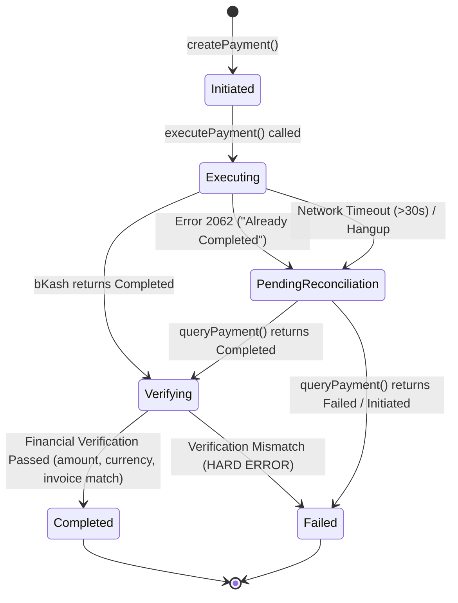

# bKash SDK — Phase 1 Technical Architecture & Design Specification

**Document Version:** 1.1.0  
**Status:** Approved for Phase 1 Implementation (Updated with Gate Review Revisions)  
**Author:** Lead TypeScript Systems Architect  
**Target Monorepo:** `iamtashanto/Bkash` (`bkash-server` and `bkash-client`)  
**Scope:** Architecture, Canonical Data Models, Token & Session Store Interfaces, Version Adapters, Execution Reconciliation, Webhook Engine & Error Taxonomy  

---

## 1. Architectural Overview & System Flow

The `bkash` monorepo delivers a modern, enterprise-grade TypeScript SDK for Bangladesh's primary mobile financial service (MFS).

### 1.1. End-to-End System Interaction Architecture

> **Security Rule:** `bkash-client` **never** communicates directly with bKash API servers and never holds credentials. It communicates exclusively with merchant backend routes powered by `bkash-server`.

```
┌──────────────┐          ┌───────────────────────┐          ┌────────────────────────┐          ┌───────────────┐
│ User Browser │          │     bkash-client      │          │   Merchant Backend     │          │   bKash API   │
│  or App UI   │          │ (Headless / React/RN) │          │    (bkash-server)      │          │   Gateways    │
└──────┬───────┘          └──────────┬────────────┘          └───────────┬────────────┘          └───────┬───────┘
       │                             │                                   │                               │
       │ 1. Click "Pay with bKash"   │                                   │                               │
       ├────────────────────────────>│                                   │                               │
       │                             │ 2. POST /api/payment/create       │                               │
       │                             ├──────────────────────────────────>│                               │
       │                             │                                   │ 3. Token Check / Refresh      │
       │                             │                                   │    (Proactive TokenStore)     │
       │                             │                                   │ 4. POST /payment/create       │
       │                             │                                   ├──────────────────────────────>│
       │                             │                                   │<──────────────────────────────┤
       │                             │                                   │ 5. Save in SessionStore       │
       │                             │ 6. Return { redirectUrl }         │                               │
       │                             │<──────────────────────────────────┤                               │
       │ 7. Redirect Browser         │                                   │                               │
       ├─────────────────────────────┴──────────────────────────────────>│                               │
       │                                                                 │                               │
       │ 8. User enters Wallet Number, OTP & PIN on bKash-Hosted UI      │                               │
       ├─────────────────────────────────────────────────────────────────┼──────────────────────────────>│
       │                                                                 │                               │
       │ 9. bKash redirects browser to merchant callbackUrl?paymentId=...│                               │
       ├────────────────────────────────────────────────────────────────>│                               │
       │                                                                 │ 10. Resolve Expected Order    │
       │                                                                 │     from SessionStore         │
       │                                                                 │ 11. Acquire Idempotency Lock  │
       │                                                                 │ 12. POST /payment/execute     │
       │                                                                 │──────────────────────────────>│
       │                                                                 │<──────────────────────────────┤
       │                                                                 │ 13. [On 2062/Timeout]:        │
       │                                                                 │     Auto-Query Reconcile      │
       │                                                                 │ 14. Financial Verification:   │
       │                                                                 │     amount, currency, invoice │
       │                                                                 │ 15. Update Session -> Paid    │
       │ 16. Render Verified Success / Redirect to Order Confirmation    │                               │
       │<────────────────────────────────────────────────────────────────┤                               │
```

---

## 2. Public API Surface & Versioning Policy

### 2.1. Versioning Contract (v0.x)
In version `0.x`:
* `apiVersion` is a **REQUIRED** option in `BkashServerConfig` (no implicit default).
* Available versions:
  * `'v1.2.0-beta'`: **Stable-in-practice**. Fully implemented and validated against existing production checkout flows.
  * `'v2'`: **Experimental**. Implemented and contract-tested, marked experimental until full sandbox end-to-end testing is signed off. The default may flip to `v2` in a subsequent minor release with a clear changelog note.

```typescript
export type BkashApiVersion = 'v1.2.0-beta' | 'v2';

export interface BkashServerConfig {
  /** Required in 0.x. Choose 'v1.2.0-beta' (stable-in-practice) or 'v2' (experimental). */
  apiVersion: BkashApiVersion;
  appKey: string;
  appSecret: string;
  username: string;
  password: string;
  /** Sandbox or Production base URL */
  baseUrl: string;
  /** Optional custom token storage (defaults to MemoryTokenStore with dev-only warning) */
  tokenStore?: TokenStore;
  /** Optional payment session store for orderId <-> paymentId resolution */
  sessionStore?: SessionStore;
  /** Optional encryption-at-rest cipher hook for token payloads */
  tokenCipher?: TokenCipher;
  /** Timeout for HTTP requests in ms (default: 30000) */
  timeoutMs?: number;
  /** Enable debug logging (PII and secrets are always redacted) */
  debug?: boolean;
}
```

### 2.2. Strict Separation of Server Status vs. Client UI States
* **Server Payment Status (`BkashPaymentStatus`):** Represents the verifiable financial state derived from bKash gateway responses and stored on the server:
  * `'Initiated'`: Session created, awaiting customer completion.
  * `'Completed'`: Executed and verified (Paid).
  * `'Cancelled'`: Customer aborted payment on gateway page.
  * `'Failed'`: Gateway declined payment or execution failed.
  * `'PendingReconciliation'`: Transient server state when execution encountered a timeout or error 2062 and query is pending.
* **Client UI State (`BkashClientState`):** Belongs **strictly** to `bkash-client`:
  * `'idle'`, `'creating'`, `'awaiting_user'`, `'verifying'`, `'success'`, `'error'`.
  * **Critical Rule:** "Paid" is **only ever** derived from verified server status, never from client state or unverified callback parameters.

### 2.3. Canonical camelCase Models

```typescript
/**
 * Expected order details supplied by caller or resolved from SessionStore.
 */
export interface ExpectedOrderDetails {
  /** Expected transaction amount in BDT (e.g. 1550 or "1550.00") */
  amount: number | string;
  /** Expected currency code, must be "BDT" */
  currency: 'BDT';
  /** Unique merchant invoice or reference number */
  invoiceNumber: string;
}

export interface CreatePaymentParams {
  amount: number | string;
  invoiceNumber: string;
  callbackUrl: string;
  orderId?: string;
  mode?: '0011' | '0001';
  intent?: 'sale' | 'authorization';
  payerReference?: string;
  metadata?: Record<string, string>;
}

export interface CreatePaymentResult {
  paymentId: string;
  redirectUrl: string;
  callbackUrl: string;
  amount: string;
  currency: 'BDT';
  invoiceNumber: string;
  status: 'Initiated';
  createdAt: string;
}

export interface ExecutePaymentParams {
  paymentId: string;
  /** If omitted, resolved automatically if sessionStore is configured */
  expectedOrder?: ExpectedOrderDetails;
}

export interface PaymentExecutionResult {
  paymentId: string;
  trxId: string;
  transactionStatus: 'Completed' | 'Authorized';
  amount: string;
  currency: 'BDT';
  invoiceNumber: string;
  /** Masked PII: e.g. "017****1234" */
  customerMsisdn?: string;
  completedAt: string;
  reconciled: boolean;
  rawResponse: Record<string, unknown>;
}
```

---

## 3. Store Architectures: TokenStore & SessionStore

To allow future unification across payment gateways (such as sibling Nagad integrations), all store interfaces and error classes follow a standardized naming convention and contract.

### 3.1. `TokenStore` & Distributed Mutex Engine

bKash strictly limits token requests to **max 2 calls per hour**. Breaching locks credentials for 1 hour.
> **Environment Isolation Requirement:** Production, staging, and local development environments **must NEVER share the same bKash credentials**, as parallel calls across environments will trigger instant credential lockouts.

```typescript
export interface TokenData {
  idToken: string;
  refreshToken?: string;
  expiresIn: number;
  obtainedAt: number; // Unix epoch ms
}

export interface TokenCipher {
  encrypt(plainText: string): Promise<string> | string;
  decrypt(cipherText: string): Promise<string> | string;
}

export interface TokenStore {
  get(appKey: string): Promise<TokenData | null>;
  set(appKey: string, token: TokenData, ttlSeconds: number): Promise<void>;
  clear(appKey: string): Promise<void>;
  /**
   * Acquire a distributed mutual exclusion lease.
   * @param appKey Unique key for the lock
   * @param ownerToken Unique UUID identifying this process/worker instance
   * @param ttlMs Lease TTL to prevent deadlocks if the holder crashes
   */
  acquireLock(appKey: string, ownerToken: string, ttlMs: number): Promise<boolean>;
  /**
   * Safe compare-and-delete unlock via Lua script.
   */
  releaseLock(appKey: string, ownerToken: string): Promise<void>;
}
```

#### Token Handling Guarantees:
1. **MemoryTokenStore (Dev-Only):**
   - Single-process in-memory store.
   - Emits a prominent console warning when running in production (`NODE_ENV === 'production'`) or multi-instance environments.
2. **RedisTokenStore (Production Standard):**
   - Lock Acquisition: `SET key ownerToken NX PX ttlMs`.
   - Safe Release: Atomic Lua script ensuring a process only deletes its own lock:
     ```lua
     if redis.call("get", KEYS[1]) == ARGV[1] then
         return redis.call("del", KEYS[1])
     else
         return 0
     end
     ```
   - **Lock Contention Polling:** If the lock is held by another process, the worker **polls the store** with short intervals (e.g. 200ms up to 3s) for the freshly minted token instead of calling grant-token.
3. **Fail-Fast Rate Limiting:**
   - On bKash rate-limit errors (HTTP 429 or call limit error), fail fast immediately by throwing `BkashRateLimitError` with a `retryAfter` timestamp.
   - **No retry storms** or tight loops.
4. **Secret Protection:**
   - Optional `TokenCipher` encrypts tokens before persistence in Redis or DB.
   - Tokens and secrets are redacted from debug logs.

---

### 3.2. `SessionStore` & Order Association

The optional `SessionStore` maps `paymentId` to the merchant's internal `orderId` and expected order values. This enables seamless, tamper-proof callback handling without requiring the merchant to trust parameters passed through the user's browser.

```typescript
export interface PaymentSession {
  paymentId: string;
  orderId?: string;
  expectedOrder: ExpectedOrderDetails;
  status: BkashPaymentStatus;
  createdAt: number;
  updatedAt: number;
}

export interface SessionStore {
  saveSession(session: PaymentSession, ttlSeconds: number): Promise<void>;
  getSession(paymentId: string): Promise<PaymentSession | null>;
  updateSessionStatus(paymentId: string, status: BkashPaymentStatus): Promise<void>;
  deleteSession(paymentId: string): Promise<void>;
}
```

* **Implementations:** `MemorySessionStore` (dev-only warning), `RedisSessionStore`, and custom DB/KV adapters.
* **Callback Flow:** When a callback reaches the server with `?paymentId=...`, the server retrieves the `PaymentSession` from `SessionStore`, reads `expectedOrder`, and proceeds to execute with complete financial verification.

---

### 3.3. Public `reconcile(paymentId)` Method
For asynchronous reconciliation tasks (cron jobs, background workers, or orphaned transaction cleanup):
```typescript
/**
 * Query and reconcile an unfinalized transaction with bounded backoff.
 * No busy loops. Safe for cron/worker invocation.
 */
reconcile(paymentId: string, expectedOrder?: ExpectedOrderDetails): Promise<PaymentExecutionResult>;
```
- Performs a single status query.
- If status is `Completed`, verifies order values, transitions session to `Completed`, and returns result.
- If still `Initiated` after timeout window, transitions to `Failed`.

---

## 4. Version Adapters Architecture (`v1.2.0-beta` vs `v2`)

| Feature | `v1.2.0-beta` Adapter (Stable in Practice) | `v2` Adapter (Experimental) |
| :--- | :--- | :--- |
| **Status in 0.x** | Production validated | Experimental (pending sandbox E2E) |
| **Auth Endpoint** | `POST /tokenized/checkout/token/grant` | `POST /v2/tokenized-checkout/auth/grant-token` |
| **Refresh Endpoint** | Re-issues grant via TokenStore cache | `POST /v2/tokenized-checkout/auth/refresh-token` |
| **Create Endpoint** | `POST /tokenized/checkout/create` | `POST /v2/tokenized-checkout/payment/create` |
| **Execute Endpoint**| `POST /tokenized/checkout/execute` | `POST /v2/tokenized-checkout/payment/execute` |
| **Query Endpoint**  | `POST /tokenized/checkout/payment/status`| `POST /v2/tokenized-checkout/payment/query` |
| **Wire Fields**     | `paymentID`, `trxID`, `merchantInvoiceNumber` | `paymentID`/`paymentId`, `trxID`/`trxId` |

The internal adapter transforms raw bKash wire responses into the canonical camelCase `PaymentExecutionResult`.

---

## 5. Execution State Machine & Reconciliation Algorithm



### The 5 Verification Steps in `executePayment()`
1. **Input / Session Resolution:** Retrieve `expectedOrder` directly from parameters or via `SessionStore.getSession(paymentId)`.
2. **Execution Mutex:** Acquire lock on `exec:<paymentId>` to prevent duplicate concurrent execution attempts.
3. **Execute Request:** Issue execute payment request with 30-second timeout.
4. **Reconciliation Interceptor:**
   - If response has `transactionStatus === "Completed"`: Proceed to Step 5.
   - If response is bKash Error `2062` ("The payment has already been completed"): Set state to `PendingReconciliation`, immediately call `queryPayment(paymentId)`. If query status is `Completed`, proceed to Step 5 with `reconciled: true`.
   - If request times out (>30s) or disconnects: Set state to `PendingReconciliation`, execute fallback `queryPayment(paymentId)`. If `Completed`, proceed to Step 5 with `reconciled: true`. If still `Initiated`, throw `BkashTimeoutError`.
5. **Strict Financial Verification (Zero Trust):**
   - `result.amount === expectedOrder.amount`: Exact match on fixed 2-decimal BDT strings.
   - `result.currency === "BDT"`.
   - `result.invoiceNumber === expectedOrder.invoiceNumber`: Exact string match.
   - **Hard Error:** If ANY value mismatches, throw `BkashVerificationMismatchError`. The transaction is flagged as compromised.

---

## 6. AWS SNS Webhook Specification (Phase 3 Specification)

bKash delivers IPN events via Amazon SNS.

### Security & Verification Protocol:
1. **`SigningCertURL` Validation:**
   - Protocol must be `https:`.
   - No port or userinfo permitted.
   - Host must match: `^sns\.[a-z0-9-]+\.amazonaws\.com$`.
   - Path must match: `^/SimpleNotificationService-[a-f0-9]+\.pem$`.
2. **Certificate Caching:**
   - Downloaded X.509 public certificates are cached in memory/store for 24 hours.
3. **Timestamp Freshness & Replay Protection:**
   - Timestamp is checked against server clock with a configurable window (default: 15 minutes, allowing for SNS delivery retries).
   - **`MessageId` Replay Store:** Dedupes received `MessageId`s to prevent replay attacks.
4. **`TopicArn` Allowlist:**
   - Validates incoming `TopicArn` against configured merchant topic ARNs.
5. **Canonical String & Signature Verification:**
   - Builds canonical message string per SNS specification for each message type (`Notification`, `SubscriptionConfirmation`, `UnsubscribeConfirmation`).
   - Verifies RSA signature using cached certificate public key (`SHA1withRSA` for `SignatureVersion: "1"`, `SHA256withRSA` for `SignatureVersion: "2"`).
6. **Authenticated Handshake:**
   - For `SubscriptionConfirmation`, HTTP GET to `SubscribeURL` is **only** performed after cryptographic signature verification.
7. **Post-Webhook Verification:**
   - Receiving a verified webhook notification does not immediately mark an order paid. The backend calls `queryPayment(paymentId)` to confirm status with bKash before updating financial records.

---

## 7. Error Taxonomy & PII Sanitization

### 7.1. Error Hierarchy

```
                            ┌────────────────────────┐
                            │       BkashError       │
                            └───────────┬────────────┘
                                        │
     ┌───────────────────────┬──────────┴────────────┬────────────────────────┐
     ▼                       ▼                       ▼                        ▼
┌──────────────────┐  ┌──────────────────┐  ┌──────────────────┐  ┌──────────────────────┐
│  BkashApiError   │  │BkashRateLimitErr │  │BkashTimeoutError │  │BkashVerificationErr  │
│ (raw code & msg) │  │(retryAfter hint) │  │                  │  │ (financial mismatch) │
└──────────────────┘  └──────────────────┘  └──────────────────┘  └──────────────────────┘
```

* **`BkashError`:** Base error class with `code`, `message`, and timestamp.
* **`BkashApiError`:** Extends `BkashError`. Holds `externalCode`, `internalCode`, `httpStatus`, and raw gateway payload. **All unknown or unmapped bKash error codes cleanly map to `BkashApiError`** without crashing.
* **`BkashRateLimitError`:** Thrown when bKash rate limit (2 calls/hr) is threatened or returned. Contains `retryAfterMs` hint.
* **`BkashVerificationMismatchError`:** Thrown when payment execution amount, currency, or invoice number fails verification against expected order values.
* **`BkashTimeoutError`:** Thrown when execution API exceeds timeout and auto-reconciliation cannot confirm payment completion.
* **`BkashDuplicateExecutionError`:** Thrown when error 2062 cannot be reconciled to a completed payment.
* **`BkashWebhookVerificationError`:** Thrown when SNS signature, certificate URL, or timestamp fails validation.

### 7.2. PII Sanitization Rules
* Customer phone numbers (`customerMsisdn`) are automatically masked in all return models and logs (e.g. `01712345678` $\rightarrow$ `017****5678`).
* Passwords, app secrets, and bearer tokens are automatically stripped from debug output and error messages.
